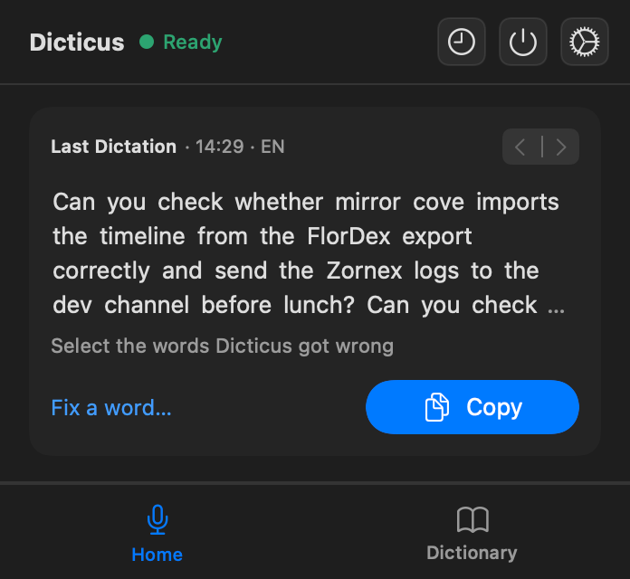

# Dicticus

A fully local dictation app for macOS and iOS. Hold a key or trigger a shortcut, speak, release — accurate text appears instantly. Fully private, no cloud dependency.

<p align="center">
  
</p>

## Features

- **Multi-Platform** — Native apps for macOS (Menu Bar) and iOS (Universal App).
- **System-wide push-to-talk** — Works in any text field on macOS.
- **Siri Shortcuts & Action Button** — Trigger iOS dictation from anywhere, even when locked.
- **On-device ASR** — Whisper large-v3-turbo via WhisperKit on macOS; Parakeet Ultra via FluidAudio on iOS — both run on the Apple Neural Engine.
- **AI cleanup mode** — Grammar, punctuation, word-order, and filler-word correction via Qwen3.5-4B (llama.cpp), on both macOS and iOS. Optional and opt-in — triggered by its own shortcut, with a deterministic fidelity guard that blocks the model from rewriting what you actually dictated.
- **Spoken punctuation** — Say "comma", "new line", etc. and it's inserted deterministically before cleanup.
- **Auto language detection** — German and English, no manual switching.
- **Live transcript panel** (macOS) — while you hold the dictation key, a small panel near your text cursor shows the words as you speak; the pasted text still comes from the full final decode. Turn it off in Settings → General.
- **Media auto-pause** (macOS) — playing media (Music, Spotify, browser video) is paused, or muted when it can't be paused, while you dictate, and resumes on release.
- **Local History & Search** — Browse and search your past transcriptions with FTS5.
- **Custom Dictionary** — Teach Dicticus how to write a word it mishears: on macOS, mark the word in a past dictation and type the correct spelling, or add it in the dictionary window, which shows each spelling with all its heard forms; import/export as CSV/JSON and add bundled starter packs.

## Requirements

### macOS
- macOS 26+ (Tahoe)
- Apple Silicon Mac
- ~1 GB disk for the ASR model, plus ~2.7 GB for the optional AI-cleanup model (downloaded only if you enable AI cleanup)

### iOS / iPadOS
- iOS 26+ / iPadOS 26+
- Any iPhone or iPad that runs iOS 26. AI cleanup needs a device with 8 GB of memory; Settings → AI Cleanup says whether yours has it.
- ~630 MB disk for the ASR model (Parakeet Ultra), plus ~2.7 GB for the optional AI-cleanup model.

## Installation

### macOS
1. Download `Dicticus.dmg` from [Releases](../../releases)
2. Open the DMG and drag Dicticus to Applications
3. Launch Dicticus — it's Developer ID signed and notarized, so it opens normally (no Gatekeeper override needed).
4. Grant Microphone and Accessibility permissions when prompted.

### iOS
1. Build from source using Xcode 26.
2. Grant Microphone permission during onboarding.
3. Download the ASR model (one-time setup).
4. Follow the in-app guides to setup the **Start Dictation** Siri Shortcut.

## Manual uninstall

Prefer the script: `./scripts/uninstall.sh` quits Dicticus, removes the app bundle, preference files, and the LaunchAtLogin entry, then prompts before deleting the ~3 GB model cache.

To uninstall by hand, remove these four locations:

1. `/Applications/Dicticus.app`
2. `~/Library/Preferences/com.dicticus.*.plist`
3. `~/Library/Application Support/Dicticus/` (contains the Qwen3.5 AI-cleanup model, the WhisperKit ASR cache, and `history.sqlite`)
4. `~/Library/LaunchAgents/com.dicticus.app.plist` (LaunchAtLogin entry; only present if you enabled "Start at login")

**TCC permission entries:** macOS does not let any app clean its own Privacy & Security entries. After uninstalling, open **System Settings > Privacy & Security** and remove **Dicticus** from **Microphone**, **Accessibility**, and **Input Monitoring** before reinstalling — otherwise stale TCC entries from previous bundle copies can block hotkeys.

## Updating the app icon

Both apps use an Icon Composer icon: `macOS/Dicticus/AppIcon.icon` and `iOS/Dicticus/AppIcon.icon`. Its layers and source artwork live in `design/app-icon/`, and `design/app-icon/ICON-COMPOSER-GUIDE.md` describes how to edit and export it.

After changing the icon, clean-build (`./scripts/build-dmg.sh` or `xcodebuild -scheme Dicticus -configuration Release clean build`) before verifying in Finder; LaunchServices caches stale icons aggressively. If the new icon does not appear after a clean build, run `killall Dock Finder` and `sudo mdutil -E /` to nuke icon caches.

## Usage

- **macOS**: Hold a hotkey, speak, release. Two configurable hotkeys — plain dictation (default ⌃⇧S) and AI cleanup (default ⌃⇧D).
- **iOS**: Trigger the **Start Dictation** shortcut via voice, Action Button, or Back Tap.
- **Dictionary**: On macOS, use the popover's Dictionary tab to add an entry, "Fix a word…" on the last dictation or in History to correct a misheard word, and "Open Full Dictionary…" to browse, search, rename and import; on iOS, the Dictionary tab.
- **History**: On macOS, the clock button in the menu bar popover opens the History window; on iOS, the History tab.

## Privacy

All processing happens on-device. No audio or text is ever sent to any server. The app uses the network only to download its models and, on the Mac, to look for and download updates.

## Tech Stack

| Component | Technology |
|-----------|-----------|
| App shell | Swift 6 + SwiftUI, MenuBarExtra (macOS) |
| ASR | macOS: WhisperKit + Whisper large-v3-turbo · iOS: FluidAudio + Parakeet Ultra (both CoreML, Apple Neural Engine) |
| LLM | llama.cpp + Qwen3.5-4B Instruct Q4_K_M (Metal) — macOS + iOS |
| Database | GRDB + SQLite (FTS5) |
| Live Activity | ActivityKit (iOS) |
| Text injection | NSPasteboard (macOS) + UIPasteboard (iOS) |

## Building from Source

```bash
# Prerequisites: Xcode 26+, xcodegen
brew install xcodegen

# macOS
cd macOS
xcodegen generate
# Unsigned Debug build, no certificate needed
xcodebuild -project Dicticus.xcodeproj -scheme Dicticus -configuration Debug -derivedDataPath build CODE_SIGNING_ALLOWED=NO CODE_SIGNING_REQUIRED=NO CODE_SIGN_IDENTITY='' build

# iOS
cd ../iOS
xcodegen generate
# Open Dicticus.xcodeproj in Xcode 26 and Run on Device/Simulator
```

A signed Release build (`xcodebuild -scheme Dicticus -configuration Release build` in `macOS/`) needs a Developer ID Application certificate in your keychain and your Apple Developer team ID exported as `DEVELOPER_TEAM_ID` before `xcodegen generate`, because `macOS/project.yml` reads it.

`Config/Local.xcconfig` is optional and gitignored. Copy `Config/Local.xcconfig.example` to it only when the gitignored `Shared/Services/PersonalLexicon.swift` exists on your machine; a clean clone builds without it.

Release builds use `./scripts/build-dmg.sh` (macOS: sign, notarize, DMG) and `./scripts/build-ipa.sh` (iOS: TestFlight upload), with the variables that `env.build.example` lists and explains how to load.

## Contributing

Pull requests are welcome. Development happens in a private repository, so a pull request here is applied there by hand and then closed with a link to the release that carries it; see `CONTRIBUTING.md`.

## License

Apache License 2.0, see `LICENSE`. Third-party attributions, including the CC-BY-SA 4.0 word lists bundled in `Shared/Resources/`, are in `NOTICE`.
